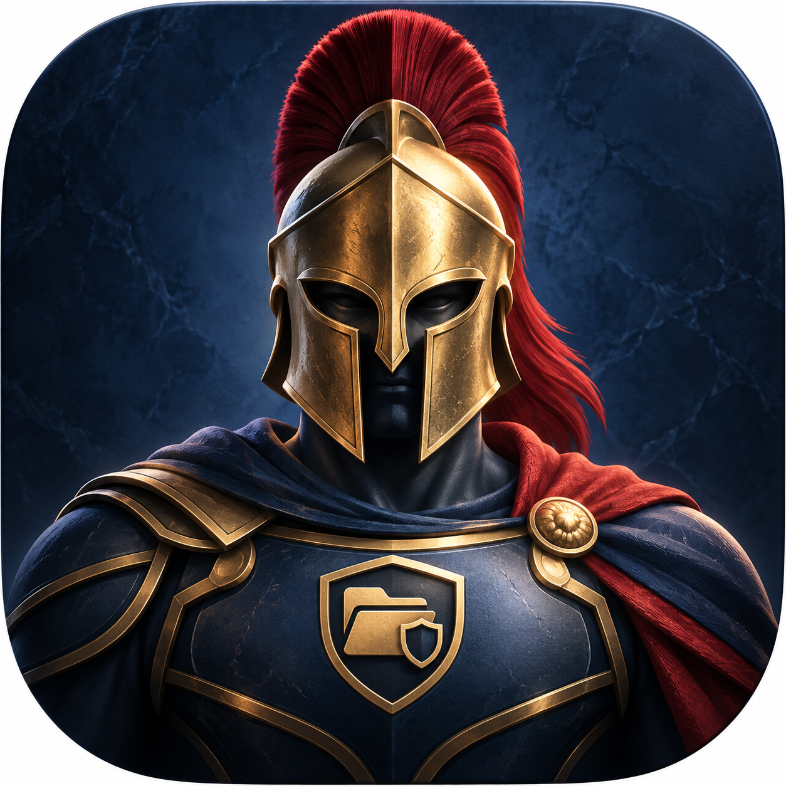

<p align="center"></p>

# Ares / Арес

[Русский](README.md) · [English](README.en.md)

Ares is an independent local macOS agent. Safe local file indexing, duplicate analysis and approved automation rules.

Version **0.29.0** · macOS14+ target · current release **Apple Silicon arm64**.
Intel/macOS14 execution remains unverified. This is a source-available project
under the custom non-commercial [LICENSE](LICENSE), not an MIT-licensed project.

[](https://github.com/Slipcast-dev/Ares-Agent/releases/tag/v0.29.0) [](https://github.com/Slipcast-dev/Ares-Agent/actions/workflows/ci.yml)

[DMG](https://github.com/Slipcast-dev/Ares-Agent/releases/download/v0.29.0/Ares-0.29.0-unsigned.dmg) · [PKG](https://github.com/Slipcast-dev/Ares-Agent/releases/download/v0.29.0/Ares-0.29.0-unsigned.pkg) · [SHA256SUMS](https://github.com/Slipcast-dev/Ares-Agent/releases/download/v0.29.0/SHA256SUMS)

## Installation

PKG/DMG are release attachments, not Git source files. They are **unsigned by
Developer ID and not notarized**. Verify SHA256SUMS before use. Local ad-hoc code
signatures provide integrity; they do not establish trusted developer identity.
Do not disable Gatekeeper globally. No automatic installation is performed.

## Build

Xcode / Command Line Tools with Swift5.9+; macOS14+ SDK. EcosystemKit is vendored:
no sibling repository is required. Yams6.2.2 is pinned in Package.resolved.

```sh
python3 scripts/verify_ecosystem_dependency.py
swift test
swift build -c release
scripts/package_app.zsh
```

Built apps: `dist/Ares.app`. Source executable names are retained for compatibility.

## Control and safety

GUI and background runtime are separate. Access starts denied; grant data access
inside this agent. Codex/Harness connection requires explicit setup in the app.
Hermes is a future extension; live Hermes support is not implemented.
No model keys or user data are bundled. See [security](SECURITY.md),
[operations](docs/OPERATIONS.md), [architecture](docs/ARCHITECTURE.md),
[performance](docs/PERFORMANCE.md), [changes](CHANGELOG.md) and [support](SUPPORT.md).

## Contributing

Read [CONTRIBUTING](CONTRIBUTING.md) and the [code of conduct](CODE_OF_CONDUCT.md).
Security reports should follow SECURITY.md; do not post personal data in issues.

[Лицензия на русском](LICENSE) · [English license translation](LICENSE.en.md).

## 0.29.0

Aligned0.29.0 distribution. Ares runtime behavior and EcosystemKit0.23.0 are unchanged; the monitor-backlog fix applies to Athena.
