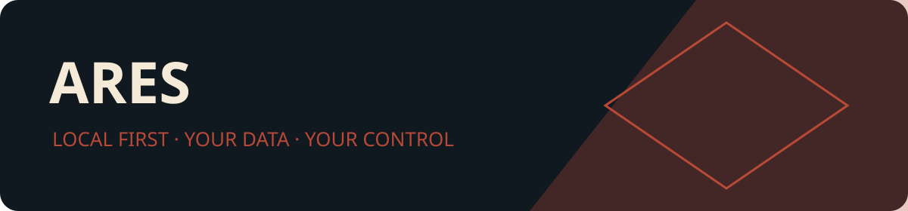

<p align="center"></p>

# Арес / Ares

[Русский](README.md) · [English](README.en.md)

Арес — отдельный локальный агент macOS. Безопасная работа с файлами, правилами и индексом.

Версия **0.38.1**. Целевая macOS14+, текущий выпуск — **Apple Silicon arm64**.
Запуск на Intel и macOS14 отдельно ещё не принят. Проект с доступными исходниками
использует собственную некоммерческую [лицензию](LICENSE), а не MIT/OSI-лицензию.

[Релиз 0.38.1](https://github.com/Slipcast-dev/Ares-Agent/releases/tag/v0.38.1) · [PKG](https://github.com/Slipcast-dev/Ares-Agent/releases/download/v0.38.1/Ares-0.38.1-unsigned.pkg) · [DMG](https://github.com/Slipcast-dev/Ares-Agent/releases/download/v0.38.1/Ares-0.38.1-unsigned.dmg) · [SHA-256](https://github.com/Slipcast-dev/Ares-Agent/releases/download/v0.38.1/SHA256SUMS) · [Проверки и ограничения](docs/RELEASE.md)


В 0.38.1 проверяется форма сериализации внутренних моделей MCP; ошибка возвращается клиенту без аварийного завершения. Документация отделяет текущие инструкции от архивов.

## Установка

PKG/DMG прикладываются к релизу отдельно от исходников. Выпуск **без подписи
Apple Developer ID и без notarization**. Перед использованием сверьте SHA256SUMS.
Локальная ad-hoc подпись защищает целостность, но не подтверждает издателя.
Не отключайте Gatekeeper глобально. Автоматическая установка не выполняется.

## Сборка

Нужны Xcode/Command Line Tools, Swift5.9+ и SDK macOS14+. Общий EcosystemKit
включён в репозиторий: соседние папки не требуются. Yams6.2.2 закреплён lock-файлом.

```sh
python3 scripts/verify_ecosystem_dependency.py
swift test
swift build -c release
scripts/package_app.zsh
```

Приложение появится в `dist/Ares.app`. Технические имена исполняемых файлов
сохранены ради совместимости модулей и клиентских конфигураций.

## Управление и безопасность

Интерфейс и фоновая служба разделены. Доступ к данным по умолчанию запрещён;
разрешения выдаются внутри каждого агента отдельно. Подключение Codex/Harness
выполняется через проверяемый план в интерфейсе. Hermes предусмотрен архитектурой,
но действующее подключение ещё не реализовано. Ключи моделей и личные данные
в комплект не входят.

[Эксплуатация](docs/OPERATIONS.md) · [Архитектура](docs/ARCHITECTURE.md) ·
[Безопасность](SECURITY.md) · [Производительность](docs/PERFORMANCE.md) ·
[Изменения](CHANGELOG.md) · [Поддержка](SUPPORT.md).

## Участие

Прочитайте [CONTRIBUTING](CONTRIBUTING.md), [правила общения](CODE_OF_CONDUCT.md)
и лицензию. Не публикуйте в issue личные файлы, профили и секреты. Сообщения об
уязвимостях направляйте по правилам SECURITY.md.


## RU/EN localization / Локализация

Предварительный выпуск 0.38.1. Полная ручная приёмка VoiceOver/клавиатуры
и аппаратные проверки остаются открытыми.
Select System, Русский or English in this agent's settings. Each agent keeps its
own language. Даты/числа следуют региону macOS. User names, paths and historical
free text retain their original language. System Settings follows macOS language.

```sh
python3 scripts/verify_localization_acceptance.py --ares-dir . --kit-dir Packages/EcosystemKit --require-reviewed-boundaries --output localization-acceptance.json
ECOSYSTEM_SKIP_LSREGISTER=1 ECOSYSTEM_APP_VERSION=0.38.1 scripts/package_app.zsh
python3 scripts/prepare_local_release.py --run --version 0.38.1 --agent Ares --use-prepared-apps --apps-dir dist --output installers/0.38.1
```

Installer output is unsigned Developer ID and not notarized. These commands
create and verify artifacts; they do not install applications or publish them.
